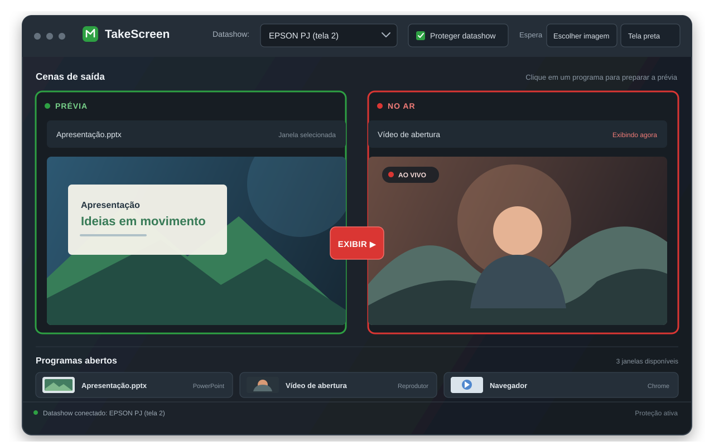

<div align="center">


# TakeScreen

**Painel do operador para escolher o que aparece no datashow (segunda tela), no estilo do Modo Estúdio do OBS.**

[](https://github.com/ChrisKauet/TakeScreen/releases/latest)
[](https://github.com/ChrisKauet/TakeScreen/releases)
[](#-download)
[](https://www.rust-lang.org/)
[](LICENSE)
[](https://github.com/ChrisKauet/TakeScreen/actions/workflows/build.yml)

<br>

[](https://github.com/ChrisKauet/TakeScreen/releases/latest/download/TakeScreen-windows-x64.zip)

<sub>Versão mais nova, portátil, sem instalar nada · <a href="https://github.com/ChrisKauet/TakeScreen/releases">todas as versões</a></sub>

<br><br>



<sub>Ilustração da interface</sub>

</div>

---

**Requisitos:** Windows 10 ou 11 (64 bits) e dois monitores (o painel numa tela e o datashow na outra).

## 📑 Índice

- [Download](#-download)
- [Funcionalidades](#-funcionalidades)
- [Atalhos](#-atalhos)
- [Ajuste da janela](#-ajuste-da-janela)
- [Dicas](#-dicas)
- [Perguntas frequentes](#-perguntas-frequentes)
- [Compilar e publicar](#-compilar-e-publicar)
- [Contribuir](#-contribuir)
- [Licença](#-licença)

## 📥 Download

| Sistema | Arquivo | Link |
|---|---|---|
| Windows 10 e 11 (64 bits) | `TakeScreen-windows-x64.zip` (portátil) | [**Baixar**](https://github.com/ChrisKauet/TakeScreen/releases/latest/download/TakeScreen-windows-x64.zip) |
| Versões anteriores | todas as versões publicadas | [Releases](https://github.com/ChrisKauet/TakeScreen/releases) |

**Como usar em 3 passos:**

1. **Baixe** o `TakeScreen-windows-x64.zip` pela tabela acima.
2. **Extraia** o zip. Sai uma pasta `TakeScreen` com `TakeScreen.exe`, `LICENSE` e `LEIA-ME.txt`.
3. **Abra** o `TakeScreen.exe` e escolha o datashow na barra de cima.

> [!TIP]
> É portátil: não precisa instalar nada (nem o Visual C++ Redistributable). As preferências ficam salvas no próprio usuário do Windows.

## ✨ Funcionalidades

| | Função | Como funciona |
|:-:|---|---|
| 🎬 | **PRÉVIA e NO AR** | PRÉVIA (verde) e NO AR (vermelho) são imagens ao vivo das janelas, desenhadas pelo próprio Windows. |
| 🗂️ | **Programas abertos** | Embaixo, em cartões com o ícone e uma prévia ao vivo: clique para ver na PRÉVIA, clique duplo para exibir direto. Os cartões ficam na ordem em que os programas abriram e não trocam de lugar quando o foco muda. Com o mouse em cima de um cartão, o título completo e o programa aparecem na barra de status. |
| ▶️ | **EXIBIR** (ou Enter) | A janela da prévia é montada no datashow *por trás* da que está no ar e só depois vem para a frente. O público vê só a troca. A janela que estava no ar volta para a tela 1 do jeito que estava. |
| ⬛ | **Limpar datashow** (ou Esc) | Cobre o datashow com a imagem de espera (ou tela preta). Com um menu aberto, Esc só fecha o menu. |
| 🖼️ | **Imagem de espera** | Em *Espera*, **Escolher imagem** (PNG ou JPEG) define o que o público vê quando nada está no ar, centralizada e sem distorcer. **Usar tela preta** volta ao preto. A imagem é lembrada na próxima abertura; se o arquivo sumir, o datashow fica preto e a barra de status avisa. |
| 🔲 | **Tela cheia do programa** (F11) | Aperta F11 na janela que está no ar (Chrome, Fotos). |
| 🛡️ | **Proteger datashow** (vem ligado) | Qualquer janela que abrir ou for arrastada para a tela 2 sem passar pelo TakeScreen volta na hora para a tela 1. A janela que sai do ar também sempre volta para a tela 1. |
| 📊 | **Apresentações do PowerPoint** | Quando o PowerPoint abre a apresentação direto no datashow, ela não é devolvida para a tela 1. Fica escondida atrás da cortina e já aparece na PRÉVIA; aperte EXIBIR para mostrar. |
| 🖥️ | **Um monitor só** | Sem datashow separado (ou com o painel na mesma tela), EXIBIR e Limpar não cobrem nada e a barra de status avisa. |
| ♻️ | **Recuperação após travamento** | Se o TakeScreen fechar com uma janela no ar (erro no programa ou processo encerrado), ela volta para a tela 1 do jeito que estava, na hora ou na próxima abertura. |
| 🔌 | **Datashow lembrado pelo nome** | O datashow é lembrado pelo nome do aparelho, então continua certo se a ordem dos monitores mudar. |
| 📋 | **Fila** | Na barra lateral (botão **☰ Fila, mídia e mixer**), monte a sequência do culto: a janela da PRÉVIA, um arquivo ou um link. **Próximo ▶** (ou PageDown) põe a próxima janela na PRÉVIA, ou já exibe se *Próximo já exibe* estiver marcado; arquivos e links abrem no programa padrão. No fim da fila, **Reiniciar** volta ao começo. A fila fica salva. |
| ⏯️ | **Mídia** | Lista o que está tocando (abas do Chrome e Edge, Spotify, Filmes e TV, VLC) com voltar, tocar/pausar e avançar, sem trazer o player para a frente e sem mostrar os controles dele no datashow. Para players que não aparecem na lista, **Tocar/pausar a janela NO AR**. |
| 🎞️ | **Vídeo no VLC sem HUD** | **Abrir vídeo no VLC (sem HUD)** abre o arquivo em tela cheia sem barra de controles, título nem avisos. A janela volta para a tela 1 pela proteção; escolha ela e aperte EXIBIR. Precisa do VLC instalado. |
| 🎚️ | **Mixer** | Volume geral e um controle por programa (volume, mudo e nível do som), sem abrir o mixer do Windows. |

## ⚡ Atalhos

| Tecla ou ação | O que faz |
|---|---|
| <kbd>Enter</kbd> | EXIBIR: leva a PRÉVIA para o ar |
| <kbd>Esc</kbd> | Limpar datashow (com um menu aberto, só fecha o menu) |
| <kbd>↑</kbd> <kbd>↓</kbd> <kbd>←</kbd> <kbd>→</kbd> | Escolhe o programa anterior ou o próximo para a PRÉVIA |
| <kbd>PageDown</kbd> | Próximo item da fila (com um menu aberto ou digitando um link, não faz nada) |
| Clique duplo no cartão | Exibe direto, sem esperar o EXIBIR |
| Botão **Tela cheia do programa (F11)** | Aperta <kbd>F11</kbd> na janela que está no ar |

## 🪟 Ajuste da janela

- *Tela inteira sem bordas*: tira a barra de título e ocupa o monitor todo. Padrão para programas comuns (PowerPoint, Chrome).
- *Maximizar*: padrão para apps da Microsoft Store (Fotos, Filmes e TV), que desenham a própria moldura.

## 💡 Dicas

- No Windows 11, desligue "Mostrar a barra de tarefas em todos os monitores" (Configurações > Personalização > Barra de tarefas) para a barra não aparecer no datashow.

## ❓ Perguntas frequentes

<details>
<summary><b>O Windows mostrou "O Windows protegeu o computador". É seguro?</b></summary>

<br>

O aviso aparece porque o `TakeScreen.exe` não tem assinatura digital paga. Clique em **Mais informações** e depois em **Executar assim mesmo**. O código é aberto e o exe é compilado pelo próprio GitHub a partir deste repositório: dá para conferir cada compilação na aba [Actions](https://github.com/ChrisKauet/TakeScreen/actions/workflows/build.yml).

</details>

<details>
<summary><b>Precisa instalar?</b></summary>

<br>

Não. O TakeScreen é portátil: basta extrair o zip e abrir o exe. Pode rodar até de um pendrive.

</details>

<details>
<summary><b>Onde ficam as configurações?</b></summary>

<br>

No usuário do Windows, em `%APPDATA%\TakeScreen` (datashow escolhido, proteção, imagem de espera e fila). Para voltar ao padrão, feche o TakeScreen e apague essa pasta.

</details>

<details>
<summary><b>Como desinstalar?</b></summary>

<br>

Apague a pasta `TakeScreen` onde você extraiu o zip. Se quiser tirar também as configurações, apague `%APPDATA%\TakeScreen` (e `%LOCALAPPDATA%\TakeScreen`, se existir).

</details>

<details>
<summary><b>Funciona com um monitor só?</b></summary>

<br>

Ele abre, mas EXIBIR e Limpar não cobrem nada, porque cobririam o próprio painel. A barra de status avisa. Ligue o datashow e escolha ele na barra de cima.

</details>

<details>
<summary><b>O PowerPoint abriu a apresentação direto no datashow. E agora?</b></summary>

<br>

Com **Proteger datashow** ligado, a apresentação fica escondida atrás da cortina e já aparece na PRÉVIA. Aperte **EXIBIR** (ou Enter) quando quiser mostrar.

</details>

<details>
<summary><b>Por que o Chrome tem um controle de volume só para todas as abas?</b></summary>

<br>

O Windows controla o volume por programa, não por aba. Para mudar o volume de uma aba só, use o próprio site (por exemplo o volume do YouTube). No painel **Mídia**, porém, cada aba que toca aparece separada e pode ser pausada sozinha.

</details>

<details>
<summary><b>O botão do VLC diz que não achou o VLC.</b></summary>

<br>

Instale o VLC pelo site oficial, [videolan.org](https://www.videolan.org). O TakeScreen procura o VLC no registro do Windows e nas pastas de programas.

</details>

## 🔧 Compilar e publicar

<details>
<summary><b>Compilar no Windows</b></summary>

<br>

Com Rust instalado:

```
cargo build --release
```

O programa sai em `target/release/TakeScreen.exe`.

</details>

<details>
<summary><b>Compilar no Linux (gerando o .exe para Windows)</b></summary>

<br>

Precisa do `gcc-mingw-w64-x86-64`:

```
rustup target add x86_64-pc-windows-gnu
cargo build --release --target x86_64-pc-windows-gnu
```

O programa sai em `target/x86_64-pc-windows-gnu/release/TakeScreen.exe`.

</details>

<details>
<summary><b>Publicar uma versão</b></summary>

<br>

Cada envio para a branch `main` gera o `TakeScreen-windows-x64.zip` na aba **Actions** do GitHub (em *Artifacts*). Uma tag começando com `v` publica o zip em **Releases**:

```
git tag v0.3.0
git push origin v0.3.0
```

</details>

## 🤝 Contribuir

[Issues](https://github.com/ChrisKauet/TakeScreen/issues) e [pull requests](https://github.com/ChrisKauet/TakeScreen/pulls) são bem-vindos.

1. Faça um fork do repositório.
2. Compile com `cargo build`.
3. Rode os testes com `cargo test`.
4. Abra um pull request explicando o que mudou.

## 📄 Licença

Distribuído sob a licença [MIT](LICENSE).

---

<div align="center">

Feito para quem opera o telão em eventos.

<a href="#takescreen">Voltar ao topo ⬆</a>

</div>
